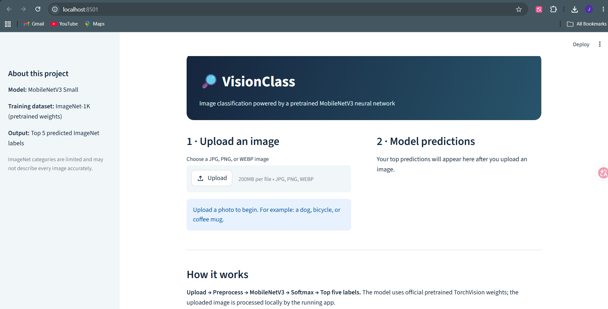
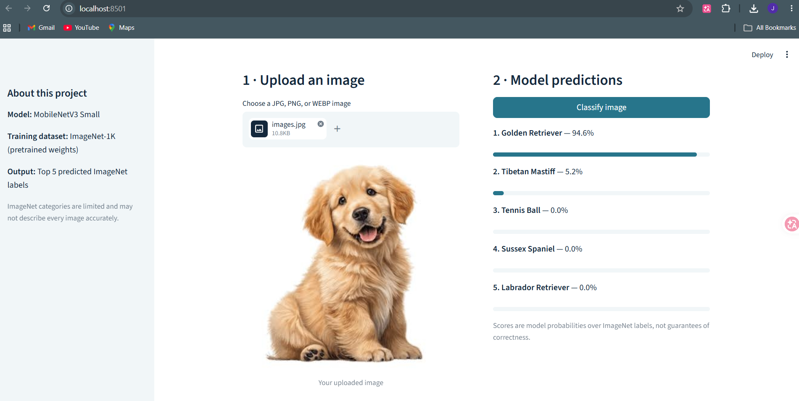
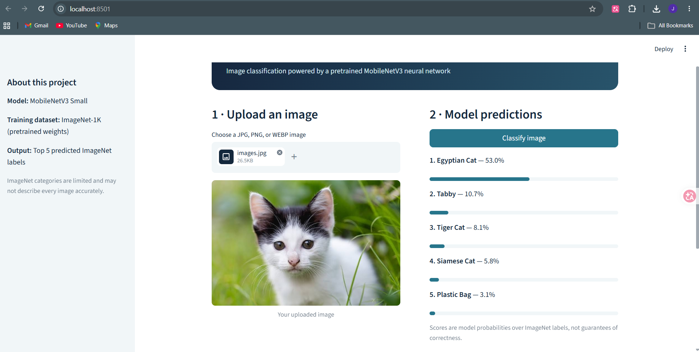
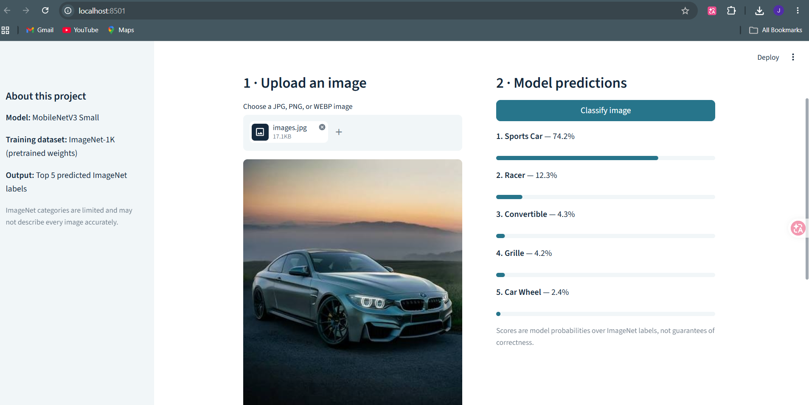
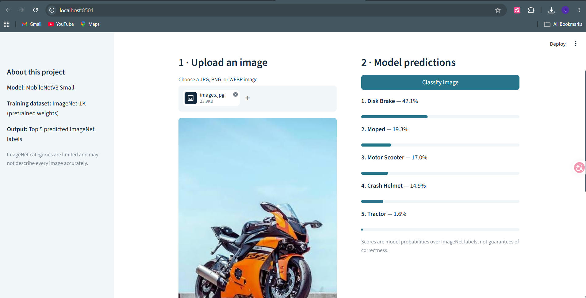

# VisionClass — Image Classification with Deep Learning

A simple, interactive **image classification web app** built with Python, Streamlit, PyTorch and TorchVision. Upload a photo and view the **five most likely ImageNet object categories** predicted by a pretrained MobileNetV3 Small neural network.

> **Scope:** This project uses an existing pretrained model for inference. It does **not** train or fine-tune a new model, and should not be described as doing so.

## Features

- Upload JPG, PNG or WEBP images (up to 10 MB)
- Automatic RGB conversion and EXIF orientation handling
- Top-five object labels with probability bars
- Friendly error messages and responsive Streamlit layout
- Inference-only model execution using `torch.inference_mode()`
- Unit tests for image processing and prediction ranking

## Tech stack

Python · Streamlit · PyTorch · TorchVision · Pillow

## Quick start (Windows, VS Code)

**Requirements:** Python 3.10+ and internet access for installation and the **first** model download. PyTorch can take some time to install because it is a large dependency.

1. Extract this ZIP and open the **VisionClass project folder** in VS Code (the folder containing `app.py`).
2. Open **Terminal → New Terminal**.
3. Run:

```powershell
python -m pip install -r requirements.txt
python -m streamlit run app.py
```

4. The app should open in your browser at `http://localhost:8501`.
5. Upload an image, then click **Classify image**. On first use, TorchVision downloads the pretrained model weights and caches them locally.

**If `python` is not recognized**, install Python and ensure it is on PATH. If PyTorch installation fails, consult the [official PyTorch installation selector](https://pytorch.org/get-started/locally/) for your Windows/Python version.

## Run tests

```powershell
python -m unittest discover -s tests -v
```

The tests exercise preprocessing and prediction ranking without downloading pretrained model weights. A full manual inference check requires running the app and uploading an image.

## How it works

1. The user uploads a picture.
2. Pillow opens it, applies EXIF orientation and converts it to RGB.
3. TorchVision applies the model's official pretrained preprocessing transforms.
4. MobileNetV3 Small predicts scores across **1,000 ImageNet categories**.
5. Softmax converts the scores to probabilities; the five highest-scoring labels are displayed.

## Limitations

- The model can only choose among ImageNet's 1,000 categories; it is **not** a general-purpose image understanding system.
- Scores are model confidence estimates, **not** proof of correctness.
- Performance varies with image quality, subject, framing and dataset differences.
- No custom training, new accuracy benchmark, or original dataset is claimed.
- Uploaded images are processed by the local Streamlit app; this project does not add cloud image storage.

## Application screenshots

The screenshots below were captured from the running Streamlit application. Predictions are examples, not guarantees of accuracy.

### Home screen



### Golden Retriever prediction



### Cat prediction



### Sports car prediction



### Motorcycle prediction



## Model attribution

Uses the official TorchVision `MobileNet_V3_Small_Weights.DEFAULT` pretrained model. See [TorchVision's MobileNetV3 documentation](https://pytorch.org/vision/stable/models/mobilenetv3.html) for model details and weights.

## Project structure

```text
visionclass-image-classification/
├── app.py
├── visionclass/
│   ├── __init__.py
│   └── predict.py
├── tests/
│   └── test_predict.py
├── .streamlit/
│   └── config.toml
├── requirements.txt
├── .gitignore
├── screenshots/
│   ├── homepage.png
│   ├── dog_prediction.png
│   ├── cat_prediction.png
│   ├── car_prediction.png
│   └── motorcycle_prediction.png
└── README.md
```
